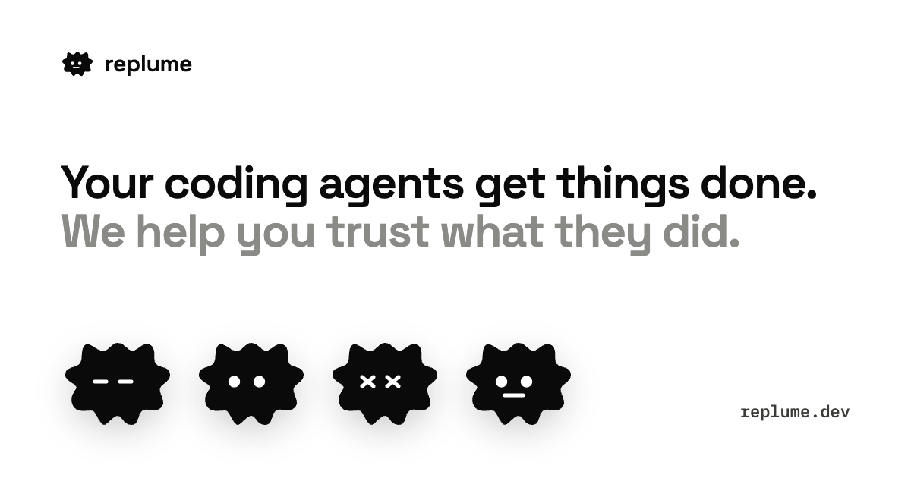

<p align="center">
  
</p>

<p align="center">
  <a href="https://replume.dev">replume.dev</a> ·
  <a href="https://x.com/rafaelibayev">@rafaelibayev</a> ·
  <a href="mailto:hello@replume.dev">hello@replume.dev</a>
</p>

# Replume

**A verification layer for AI coding agents.** Replume runs on top of Claude Code, Codex, Cursor and soon Hermes Agent. It watches each step the agent takes, steers it back when it leaves the task, and checks the finished commit against what you actually asked for. Then you know what the agent did without re-reading the whole diff.

Replume runs checks alongside your agent. Auto can ask a second installed agent to review the result. See [Privacy](https://replume.dev/docs/privacy/) for what is sent and how to turn it off.

> **Free during beta.** Install the CLI from npm. This repository is for feedback and public project information.

## Why

Agents say "done" when the task is not done. Tests can pass while the behaviour is wrong, and agents sometimes weaken the tests to get green. In [one 2026 study](https://arxiv.org/abs/2606.09863), when coding agents failed a task and stated an outcome, they reported success 75.8% of the time.

Review gets slower as agents produce more code. Replume moves the checking to where the work happens.

## How it works

1. **Install and set up in your Git repository.**

   ```sh
   npm install -g replume-cli
   replume init
   ```

   Use `replume init --cursor` or `replume init --codex` to explicitly install those agents’ hooks. In Codex, review and trust them with `/hooks`. Follow the commit instructions in init’s `Next:` block.

2. **Start a fresh agent session in that same folder.** Open Claude Code (`claude`), Codex (`codex`), or Cursor with this repo open. Give the agent your task as its first message. In the default Auto mode, Replume makes the task contract from that prompt. You can run `replume watch` in a second terminal.
3. **Read the session report.** After a supported finish hook runs, use `replume report --session`. Read the verdict, reason, and Next line.

**A diff and green tests are not enough on their own.** In the default flow without scenarios, `replume verify` re-checks a commit and needs recorded agent-session evidence to return PASS. If you made the change without a recorded session, it can return `INCOMPLETE [NO_AGENT_SESSION]` even when tests pass. For a first run, start the agent and give it the task after init. Standalone `replume verify --task` is planned for 0.2.13.

See [Start](https://replume.dev/docs/) for setup and [Agents](https://replume.dev/docs/agents/) for what each adapter records.

## Commands

| Command | What it does |
|---|---|
| `replume init` | Set up hooks and configuration in this repository |
| `replume watch` | Follow recorded steps and test results |
| `replume report --session` | Read the saved session report |
| `replume verify` | Re-check a committed change against the task and available evidence |

## Feedback

Questions, bugs and ideas are welcome in [Issues](../../issues). For beta access, write to [hello@replume.dev](mailto:hello@replume.dev).

---

Built by [Rafael Ibayev](https://x.com/rafaelibayev). Replume is not affiliated with Anthropic, OpenAI, Cursor or GitHub; their names are used only to say what Replume works with.
